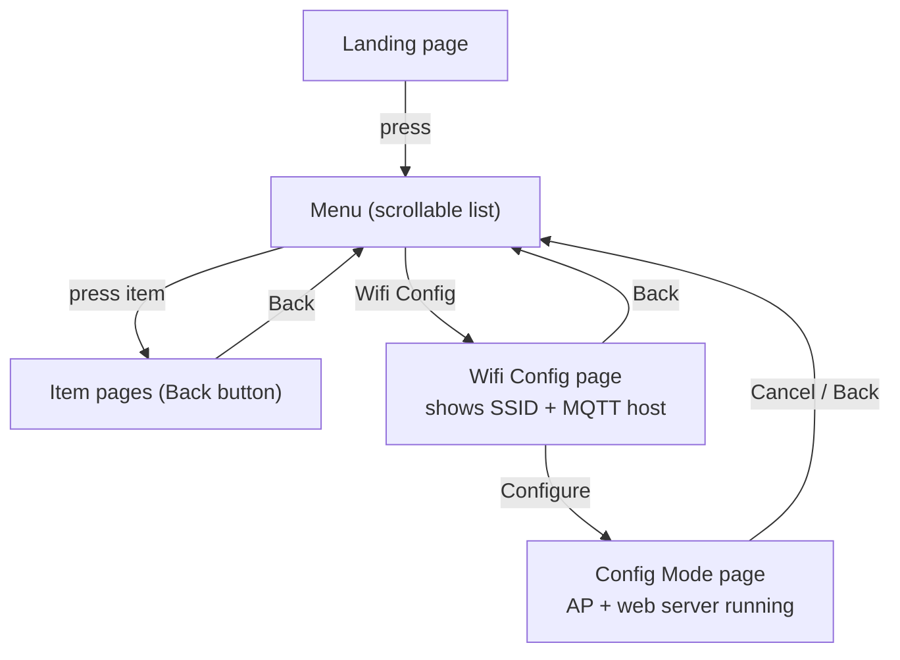

# Custom Wi-Fi Configuration

Runtime Wi-Fi and MQTT provisioning for the **ESP32-S3**, driven by a **20x4 I2C LCD** and a **KY-040 rotary encoder**. Instead of hardcoding credentials in the firmware, the device can turn itself into a Wi-Fi access point, serve a small configuration web page, and receive the Wi-Fi SSID/password and MQTT broker settings from your phone or laptop, with no reflashing.

Built with **PlatformIO** and the **Arduino framework**.

> **Status:** work in progress. The device already hosts the configuration page and receives all six fields. For now the received values are printed to the Serial Monitor and kept in RAM. Connecting to Wi-Fi/MQTT with them and saving them to flash are the next steps (see [Roadmap](#roadmap)).

---

## Features

- **Menu UI on a 20x4 LCD**, navigated with the rotary encoder (rotate to scroll, press to select)
- **Page-based architecture**: every screen is its own class behind a common `IPage` interface
- **Wi-Fi Config page** that shows the received SSID and MQTT broker host, with vertical scrolling for content longer than 4 rows
- **Configuration mode (SoftAP + web server)**: the ESP32 creates its own network and serves an HTML form
- **Six configuration fields** in one form:
  - Wi-Fi SSID and password
  - MQTT broker host, port, username *(optional)* and password *(optional)*
- **Server-side validation** of the submitted form (SSID and host required, port 1-65535)
- **Cancel at any time**: leaving the configuration page always shuts the access point and web server down

---

## Hardware

| Component | Notes |
| :--- | :--- |
| ESP32-S3 DevKitC-1 | Board used in `platformio.ini` |
| 20x4 character LCD with I2C backpack (PCF8574) | Default I2C address `0x27` (some backpacks use `0x3F`) |
| KY-040 rotary encoder | CLK, DT and SW (push button) |

### Wiring

| Signal | ESP32-S3 GPIO |
| :--- | :--- |
| LCD SDA | `8` |
| LCD SCL | `9` |
| Encoder DT | `5` |
| Encoder CLK | `4` |
| Encoder SW (button) | `6` |

Power the LCD backpack and the encoder according to their modules' requirements (the LCD backpack is typically powered from 5V, the KY-040 from 3V3) and connect all grounds together. The encoder pins use the ESP32's internal pull-ups.

> Pins and the LCD address are defined in `src/main.cpp` and `src/managers/sensor_manager.cpp`. Change them there if your wiring differs.

---

## Software

- [PlatformIO](https://platformio.org/) (VS Code extension or CLI)
- Platform: `espressif32`, framework: `arduino`, board: `esp32-s3-devkitc-1`

Libraries (installed automatically by PlatformIO from `platformio.ini`):

| Library | Purpose |
| :--- | :--- |
| `marcoschwartz/LiquidCrystal_I2C` | 20x4 I2C LCD driver |
| `madhephaestus/ESP32Encoder` | Hardware-assisted rotary encoder counting |

`WiFi.h` and `WebServer.h` ship with the ESP32 Arduino core, so no extra dependency is needed for the access point and web server.

---

## Getting Started

```bash
git clone https://github.com/LeoDoesCode17/custom-wifi-configuration.git
cd custom-wifi-configuration
```

1. Open the folder in VS Code with the PlatformIO extension installed.
2. Wire the hardware as described above.
3. Build and upload:
   ```bash
   pio run --target upload
   ```
4. Open the serial monitor (115200 baud):
   ```bash
   pio device monitor
   ```

---

## How to Use

### Navigating the UI

| Action | Result |
| :--- | :--- |
| Rotate the knob | Move the cursor `>` down/up (the list scrolls when needed) |
| Press the knob | Open the selected item / press the selected button |

### Configuring Wi-Fi and MQTT

1. From the landing page, press the knob to open the **menu**.
2. Scroll to **Wifi Config** and press the knob.
3. Choose **Configure** and press the knob. The device starts its access point and the LCD shows the connection guide:
   ```
   AP: ESP32_IoT_Setup
   Pass: 12345678
   Open: 192.168.4.1
   > Cancel
   ```
4. On your phone or laptop, join the Wi-Fi network **`ESP32_IoT_Setup`** (password **`12345678`**).
5. Open **`http://192.168.4.1`** in a browser and fill in the form:

   | Field | Required | Notes |
   | :--- | :---: | :--- |
   | Wi-Fi SSID | yes | Name of the network the device should use later |
   | Wi-Fi Password | no | Leave empty for open networks |
   | MQTT Broker Host | yes | Hostname or IP of the broker |
   | MQTT Broker Port | yes | 1-65535, defaults to `1883` |
   | MQTT Username | no | Leave empty for no authentication |
   | MQTT Password | no | |

6. Press **Save**. The LCD shows `Credentials saved!` and the values are printed to the Serial Monitor:
   ```
   [WifiConfig] Configuration received:
     Wi-Fi SSID    : ...
     Wi-Fi Password: ...
     MQTT Host     : ...
     MQTT Port     : 1883
     MQTT Username : (none)
     MQTT Password : (none)
   ```
7. Press the knob to return to the menu. The access point and web server are turned off automatically.

To abort at any point, select **Cancel** on the configuration screen. Back on the **Wifi Config** page, the received SSID and MQTT host are displayed (scroll with the knob if they do not fit).

---

## Architecture

### Page flow



### Layers

```
src/
├── main.cpp                       # setup(): LCD, sensors, page manager. loop(): web server + pages
├── core/
│   └── type.h                     # shared data types (Wi-Fi / MQTT configuration structs)
├── managers/
│   ├── page_manager.*             # owns the active page, forwards encoder input, handles navigation
│   ├── sensor_manager.*           # thin facade over the sensor drivers (pins live here)
│   └── wifi_config_manager.*      # SoftAP + WebServer + received configuration
├── sensors/
│   └── rotary_encoder.*           # KY-040 driver: position + debounced button press
└── ui/
    ├── i_page.h                   # IPage interface: onEnter / onExit / update
    ├── page_id.h                  # enum of all pages
    ├── lcd_utils.h                # helper to print padded lines without flicker
    ├── landing_page.*             # first screen
    ├── menu_page.*                # scrolling cursor menu
    ├── sub_page.*                 # reusable item page with a Back button
    ├── wifi_configuration_page.*  # Configure / Back + saved values, scrollable
    └── config_mode_page.*         # configuration guide + Cancel
```

> The tree above reflects the intended layout. Adjust it if your repository differs.

| Piece | Responsibility |
| :--- | :--- |
| `IPage` | Common interface every screen implements. `PageManager` only talks to this interface |
| `PageManager` | Keeps the current page, resets the encoder on every navigation, passes `encoderDelta` and `buttonPressed` to the page each loop |
| `SensorManager` / `rotary_encoder` | Hide the encoder driver behind simple functions (`getEncoderPosition`, `wasEncoderButtonPressed`, ...) |
| `wifi_config_manager` | `start()` / `stop()` the access point and web server, `update()` serves HTTP clients from `loop()`, getters return the received `WifiConfig` and `MqttConfig` |

### Adding a new page

1. Add an ID to `PageId` in `ui/page_id.h`.
2. Create a class that implements `IPage` (or reuse `SubPage`).
3. Map the ID to the page instance in `page_for()` in `managers/page_manager.cpp`.
4. To reach it from the menu, add an entry to the `ITEMS` array in `ui/menu_page.cpp`.

---

## Configuration

| What | Where | Default |
| :--- | :--- | :--- |
| Access point name / password | `src/managers/wifi_config_manager.cpp` | `ESP32_IoT_Setup` / `12345678` |
| LCD I2C address and size | `src/main.cpp` | `0x27`, 20x4 |
| I2C pins | `src/main.cpp` | SDA `8`, SCL `9` |
| Encoder pins | `src/managers/sensor_manager.cpp` | DT `5`, CLK `4`, SW `6` |
| Encoder button debounce | `src/sensors/rotary_encoder.cpp` | 30 ms |

If turning the knob moves the cursor in the wrong direction, flip the sign of the encoder delta in the page's `update()` (or swap the DT and CLK pins).

---

## Security Notes

This is a development build:

- The received Wi-Fi and MQTT passwords are **printed to the Serial Monitor** for debugging. Remove those prints before deploying.
- The access point uses a **fixed, well-known password**. Consider deriving the SSID/password from the chip's MAC address.
- The configuration page is served over plain HTTP, protected only by the WPA2 access point.
- Received values are stored in RAM only and are lost on reboot.

---

## Roadmap

- [ ] Connect to the configured Wi-Fi network with `WiFi.begin()`
- [ ] Persist Wi-Fi and MQTT settings in flash with NVS (`Preferences`)
- [ ] Connect to the MQTT broker using the received settings
- [ ] Captive portal DNS so phones open the page automatically
- [ ] Wi-Fi network scanner (dropdown of nearby SSIDs in the form)
- [ ] Derive the access point name from the MAC address
- [ ] Replace the placeholder item pages with real content

---

## License

No license specified yet. Add a `LICENSE` file to define how others may use this project.